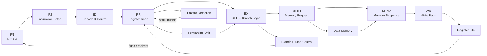

# 8-Stage Deep-Pipelined 32-Bit RISC-V Processor

<div align="center">


</div>

## About this project
This project presents the design and verification of an 8-stage deep-pipelined 32-bit RISC-V processor implemented in Verilog. The architecture is designed to model realistic CPU behavior, including instruction fetch, decoding, register read, execution, memory access, and write-back stages.

The processor focuses on resolving common pipeline issues such as:

- data hazards,
- forwarding logic,
- load-use stalls,
- branch/jump control hazards,
- and flush/redirect handling.

The design is intended for academic, research, and learning purposes in digital design, computer architecture, and HDL-based processor verification.

## Objectives
- Implement a fully pipelined 32-bit RV32I-inspired datapath in Verilog.
- Study hazard detection and forwarding techniques for a real CPU pipeline.
- Validate the design with a self-checking testbench and waveform analysis.
- Demonstrate how a microarchitectural design can be verified through simulation.

## Pipeline overview
The processor is organized into the following stages:

| Stage | Description |
|---|---|
| IF1 | Instruction fetch stage 1 |
| IF2 | Instruction fetch stage 2 |
| ID | Decode and instruction control |
| RR | Register read and operand preparation |
| EX | ALU and branch resolution |
| MEM1 | Memory request phase |
| MEM2 | Memory response and load-data handling |
| WB | Write-back to register file |

## Core features
- 32-bit RV32I datapath
- Deep pipeline architecture
- Forwarding unit for operand bypassing
- Load-use hazard detection and stall insertion
- Branch and jump target resolution
- Flush logic for mispredicted instructions
- Separate instruction and data memory paths
- Self-checking testbench for validation
- Waveform-based debugging in ModelSim

## Block diagram


## Verification status
The design logic has been validated using Python-based checks and structural validation. The Verilog simulation itself must still be completed in ModelSim/Questa for final hardware-level verification.

| Check | Tool | Result |
|---|---|---|
| Instruction encoding validation | `tools/rvasm.py` | Passed |
| Golden reference comparison | custom scripts | 0 mismatches |
| Structural lint checks | `tools/lint_check.py` | 0 errors |
| Pipeline cycle model validation | `tools/pipeline_model.py` | Passed |

## Project structure
```text
riscv8/
├── rtl/              # RTL design files
├── tb/               # Testbench for processor validation
├── sim/              # ModelSim script files
├── tests/            # Generated test patterns and expected outputs
├── tests_src/        # Assembly source programs
├── docs/             # Architecture and timing notes
├── tools/            # Assembler, model, and validation scripts
├── README.md
├── modelsim.ini
├── LICENSE
└── ...
```

## Running the simulation
Open the repository in a ModelSim-compatible environment and run the scripts from the project root:

```bash
cd <project_path>/riscv8
do sim/run_all.do
```

For a no-GUI run:

```bash
cd <project_path>/riscv8
do sim/run_nogui.do
```

## Expected behavior
The testbench is designed to validate the processor against known expectations and print pass/fail results for each program. Successful execution should report all test cases passing.

## Waveform interpretation
The waveform output is used to confirm that instructions move correctly across the pipeline. Key signals of interest include:

- pipeline occupancy,
- stage activity (`IF1`, `IF2`, `ID`, `RR`, `EX`, `MEM1`, `MEM2`, `WB`),
- hazard or stall conditions,
- branch redirect and flush events,
- and memory/register update activity.

A healthy waveform should show continuous movement of instructions through the pipeline with expected stalls and flushes when hazards occur.

## Why this project matters
This processor design is a practical demonstration of real microarchitecture concepts used in modern CPUs. It helps bridge the gap between theoretical computer architecture and hardware implementation, giving students and designers a deeper understanding of:

- pipelining,
- control logic,
- hazard resolution,
- and verification through simulation.

## License
This project is licensed under the MIT License. See the [LICENSE](LICENSE) file for details.

## Author
Designed and implemented for an advanced digital design and computer architecture project.

